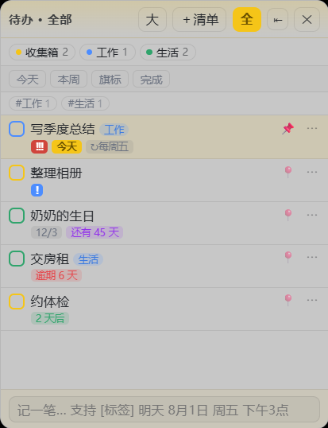
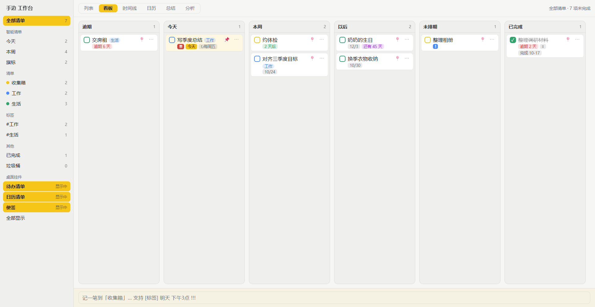

# 手边 · 桌面待办 / 日历 / 便签

透明桌面待办 / 日历 / 便签三件套，Windows 桌面插件。功能对齐
[小黄条 YYNote](https://www.yynote.cn/) 的 **T2 核心**，自研开源实现（MIT）。

<table>
  <tr>
    <td><br><b>桌面待办</b> 标签 / 置顶 / 今天 / <code>↻每周五</code> / 倒数 / 逾期</td>
    <td><br><b>桌面日历</b> 节假日与调休 / 农历 / 跨天标记</td>
    <td><br><b>桌面便签</b> <code>[标签]</code> 自动归类、只标记不剥离</td>
  </tr>
  <tr>
    <td colspan="3"><br><b>工作台 · 看板</b> 列是时间桶：<code>逾期 / 今天 / 本周 / 以后 / 未排期 / 已完成</code>，拖卡片即改期</td>
  </tr>
</table>

> 截图里全是**一次性合成演示数据**（截完即还原真实库），不含任何真实待办内容。

> **名字**：产品叫「手边」（就在手边的意思）。代码内部标识仍是历史的 `xhy`/`dev.xhy.desktop`
> —— 后者是**数据目录名**，改名等于丢用户数据，所以刻意不动。三处显示名见
> `app/src-tauri/src/lib.rs::BRAND`、`app/src/shared/brand.ts`、`tauri.conf.json` 的 `productName`。

> 状态：**可安装、可运行、核心功能已实机验证**。测过什么、怎么测的、哪些没测到，
> 逐条写在 [docs/AUDIT.md](docs/AUDIT.md)，不糊弄。

---

## 下载与运行

| 交付物 | 从哪拿 | 说明 |
|---|---|---|
| 安装包 | [Releases](../../releases/latest) → `Shoubian_0.1.0_x64-setup.exe` | NSIS，1.81 MiB，当前用户安装（免管理员）。装到 `%LOCALAPPDATA%\Shoubian\xhy.exe`、控制面板显示 **Shoubian** 并可卸载 —— 目录名与显示名跟着 `productName: Shoubian` 走，**里面的 exe 仍叫 `xhy.exe`**（那名字来自 Cargo 的 bin 名，不受 productName 影响），所以进程名、脚本里的 `Get-Process xhy` 判据都不用改 |
| 绿色版 | [Releases](../../releases/latest) → `xhy-portable.zip` | 2.22 MiB，解压出单个 `xhy.exe`（4.91 MiB）直接双击运行 |
| 自己构建 | 见下方「[从源码构建](#从源码构建)」 | `npm run tauri:build` 一次出齐上面两样 |

> **安装包未做代码签名**，首次运行 SmartScreen 会警告"未知发布者"。

> **比对安装包与构建产物时，会有 3 个字节不一样，这是正常的**：NSIS 安装脚本在落地时把二进制里的 `TAURI_BUNDLE_TYPE_VAR_UNK` 标记改写为 `NSS`（安装型分发的标记，长度相同所以文件字节数一致）。所以"**同一次构建**的 `target/release/xhy.exe` 与装完那份"MD5 不同、大小相同、只差 3 字节 ≠ 被篡改。
>
> **但别拿哈希/大小跨构建比对**：实测同一份源码（工作区干净、`git status` 无改动）连打两次，产物差 512 字节、MD5 完全不同 —— Rust release 构建不是逐字节可复现的（LTO/`strip`/内嵌构建路径与时间戳）。要确认"装上去的就是当前源码那份"，靠的是**源码状态**（`git status` 干净 + 构建时间在建后）与**行为**（`tools/verify-multiday-and-parse.ps1 -SrcExe "$env:LOCALAPPDATA\Shoubian\xhy.exe"` 跑一遍真机断言），不是哈希。

依赖 **WebView2 运行时**（Win10/11 一般自带；缺了会白屏，去 [微软官网](https://developer.microsoft.com/microsoft-edge/webview2/) 装 Evergreen）。

> **升级提示**：覆盖安装会先结束正在运行的 xhy 再替换文件，且装完**不会自动重启**，需手动启动一次。开发期反复覆盖安装时很容易误判成"安装失败"——实际是旧进程锁着 exe。

首次运行自动播种三件套：右上「待办清单」、其下「日历清单」、左上「便签」。

---

## 功能

### 桌面待办清单
- 多清单（标签页切换、拖标签排序、`＋清单`新建、`全`看聚合视图）
- `[标签]` 自动打标（半角 `[]` 与全角 `［］` 都认）；**已有待办也能编辑标签**——`⋯` 面板里有「标签 / 打标签 / 常用」三行（常用按使用频次给建议，一键添加；`#` 前缀自动剥离；规则收在 `shared/tags.ts` 纯函数，14 项测试锁住）
- **标签栏聚合 + 点击筛选**：挂件内出现过的标签汇成一行（`#工作 3`、`#家 2`，按使用次数降序），点一下即只看该标签，再点取消；可与下面的筛选口径**叠加**
- **智能筛选**（对照滴答清单）：`今天`（今天+逾期）/ `本周`（本周日内含逾期）/ `旗标`（带优先级的）/ `完成`（只看已完成）——再点一次取消；筛选态持久化在挂件上（与日历视图同一套做法），跨重启保留，多个待办挂件各自记住。原先还有一档 `待定`（没写到期日的），现已撤掉：**快速添加没写日期默认就是今天**，不再产出"记完找不到"的无日期条目（`matchScope` 里的 `someday` 判据保留——老挂件状态里可能存着这个 filter，删判据会让它变成静默空视图）
- **优先级旗标**（对照滴答/Todoist，调研中使用率最高的任务字段）：一句话输入 `!!! 修水管` / `!! 写总结` / `! 整理相册` 或 `P1`/`P2`/`P3` 即打标；也可在 `⋯` 面板点选。旗标配色高红/中橙/低蓝，**排序权重仅次于置顶**（高→中→低→无）
  - 误判防护：只认**独立成词**的 ASCII `!`，因此 `买3个!`、`Hello!`、`太好了！`(全角)、`a != b`、`解释!!!一下` 一律不当优先级——有 6 条专门测试锁死这些边界
- **一句话智能识别日期 + 时间**：`明天 交周报`、`周五 复盘`、`8月1日 体检`、`12-25 圣诞`、`9:30 站会`、`下午3点半 面试`、`晚上8点半 跑步`，以及全写日期 `2031-10-20` / `2031/10/20` / `2031.10.20` / `2031年10月20日`（可省「日」）—— 自动抽出到期日与时间并从标题剥离；识别到时间即落成提醒。**没写日期的条目默认到期日就是今天**（不再是"无到期日"）；`周五` 在周五当天=今天；`2026-02-30`、`20311020` 这类不认（前者不存在，后者更像单号）
- **Markdown 导入 / 导出**：设置页与托盘菜单各一对。导出是给人看的 GitHub 任务清单（`## 📋 清单名` + `- [ ] 标题 \`tag\` · 📅 日期 · 🔔 提醒`）；导入认我们自己的格式**也**认第三方工具（Kite 等）导出的 `## YYYY-MM-DD` 日期分组，**合并语义**：同名清单归并、条目按「标题+到期日」去重、整份一次落盘，再导一遍不产生重复；空条目被丢弃但**条数会报出来**（不静默少导入）
- 拖拽排序（指针自绘拖拽，非 HTML5 DnD）、一键置顶（置顶项高亮 + 恒排最前）
- **到期提醒**：Windows Toast + 行内 🔔；逾期也补提醒一次
  - **多个提醒时间**（对照滴答"Choose multiple alert times"）：一条待办除主提醒外可加任意个额外时点，各时点独立去重触发
  - **持续提醒**（对照滴答"Constant Reminder"）：开启后逾期未完每隔 2 分钟重弹，直到完成
  - 提醒决策是**纯函数** `plan_fires()`（不读时钟、不写库），所以"多提醒/持续/去重/节流"这套组合行为可被完整单测覆盖
- **重复规则自动生成**：每天/每周(可多选星期)/每月(含"当月末")/每年/工作日/**官方工作日**/**节假日**/**农历每月**/**农历每年**；完成时自动建下一条
  - **官方工作日 / 节假日**（对照滴答 "official working days and holidays"）：区别于纯"周一至周五"——扣除法定假日、把调休上班的周末算作工作日。数据用已打包的 holiday-cn，`day_off()` 一个判据同时覆盖两种情况（表内看 official、表外看是否周末）
  - **农历每月 / 农历每年**（对照滴答 "lunar yearly and monthly cycles"，如农历生日、每月初一）：用 lunar-lite 天文算法，处理两个坑：目标月是 29 天小月而基准是三十 → clamp 到廿九（否则转换报错、展开链断）；基准在闰月而目标年无同名闰月 → 回退普通月
- **日期倒数**：`还有 65 天` / `已经 23 天`
- **按完成日期自动归档**：完成满 N 天（默认 7）移入 `archive/*.jsonl`，主表只留活动项；「已完成」可展开回顾
- **逾期自动延期**（对照 Kite，**默认关**）：开启后启动时把已逾期未完成的待办到期日推到今天，提醒时间同步平移并重置（今天还能提醒一次）；未来到期日与已完成项绝不动
- **导出 Markdown**（对照 Kite）：托盘「导出 Markdown…」或设置页按钮，按清单分节、`- [x]` 勾选、标签/日期/提醒/重复/备注齐全，日程与便签各自成节；JSON 导出仍是完整备份通道
- 双击改名、`⋯` 弹出编辑面板（优先级/到期/提醒/**加提醒**/**持续提醒**/倒数/重复/删除）

### 桌面日历清单
- 月 / 周 / 日 三视图（点某格进日视图）
- **中国法定节假日 + 调休**：红=放假、绿=调休上班；数据来自 [holiday-cn](https://github.com/NateScarlet/holiday-cn)（MIT），构建期打包，离线可用
- 日程角标、点日期进日视图看清单（月视图**单击**、周视图**双击**下钻）、双击日程改时间/标题
- **农历**：每格显示农历（初一显示"正月/闰二月"等月名并高亮，其余显示"初九/廿四"日名）。lunar-lite（MIT）纯本地天文算法，无网络无数据文件；与 YYNote 逐格对照一致
- **带到期日的待办自动出现在日历上**（查询时从待办**派生**，不落库；已排进日历的待办不重复显示；在日历上改名/改期直接作用于待办，✕ 只清到期日不删待办）
- **完成态一致性**：待办勾掉后，它在日历上的一切痕迹（派生条目 + 当初拖进去生成的关联日程）同时消失；取消勾掉即恢复。日程数据不被删除，只是不显示。
- **重复日程**：日视图行上 `↻` 设每天/每周/每月；库里只存**一条母记录**，查询时按规则**虚拟展开**到每一天（对齐小黄条观感，又不为长期重复项堆积数据、改规则一处生效）。重复待办拖上日历会自动继承规则
- **从待办挂件拖一条到日历格 → 生成日程**（并回写该待办的到期日）；拖日程到别的格子 → 改期
- 待办行 `⋯` 菜单里的**「排到…」**走同一后端命令，不依赖拖拽（键盘可达，也是拖拽失效时的兜底）
- 日程按清单配色，来源标记 `待办`

### 桌面便签清单
- 一个窗口内多张便签翻页（`‹ ›`）、`＋`新建
- 7 种底色（含深色板自动配浅字）、字号、透明度逐张可调
- **`[标签]` 自动归类**：与待办不同，便签正文**原样保留**（只标记不剥离）——用户是"先建空便签再打字"，删掉敲进去的字符比留着更糟
- **一键置顶**（`⋯` 菜单）：置顶便签恒排最前
- 输入 600ms 防抖落盘，多行、emoji 正常

### 周 / 月总结（对照滴答清单的"回顾"）
- 快速添加窗「总结」标签页，`本周` / `本月` 一键切换
- **本地统计是主体**：完成数、新建数、遗留未完成、完成率、上一周期环比（↑↓百分点）、按天柱状图、按清单/标签分布、产出最高的一天、遗留项清单。**离线可用、永远算得出**（含已归档项，月总结不漏历史）
- **AI 润色是可选增强**：把统计摘要交给大模型写成一段人话。设置里填 OpenAI 兼容的 `base URL / API Key / 模型名`（默认预填阿里云百炼千问 `qwen-plus`）。**没配 key、断网、模型报错一律降级回本地摘要**——AI 挂了不影响功能
- Key 明文存本机数据目录（与用户数据同权限），程序**绝不**读取系统里其它工具的凭据、也不擅自外发；发请求前用户必须自己填 key

### 主窗口 · 工作台（对照滴答三栏）
托盘「打开工作台」唤出，**左键单击托盘图标**也直接开工作台（右键仍弹菜单，`show_menu_on_left_click(false)` 保证左键不菜单）。**独立普通窗口**（原生标题栏、可缩放、进任务栏），与桌面挂件是两种形态：挂件是"瞄一眼"的桌面常驻，工作台是"坐下来整理"。看板/时间线要横向铺开，388px 挂件装不下，硬塞只会把两个形态都做坏——所以分开。
  - 判定逻辑抽成纯函数 `tray_opens_main`（**5 项单测**锁死）：只认**左键 + 松开**。原因：托盘图标在系统任务栏里，合成鼠标消息够不到，本机自动化环境的 `SendInput` 又被完整性级别拦截，这条交互只能靠单测锁住，否则"单击/双击/左右键"全靠肉眼。`MouseButtonState::Up` 的语义已从 tray-icon 的 Windows 实现源码确认是**松开**（`WM_LBUTTONUP → Up`）——tauri 的文档注释把 Up/Down 写反了，**别信注释**。
  - ✅ **真机人工确认**（自动化验不了这一条，只能人工）：单击托盘图标 → 成功打开工作台。

- **三栏**：左侧**作用域菜单**（智能清单 / 清单 / 标签 / 已完成 / 垃圾桶 / 桌面挂件，每项带计数，对照滴答侧栏）+ 中间视图 + 底部输入框。数据与挂件**同源**（同一 store + `xhy://changed` 广播），改哪边都实时同步
- **清单操作菜单**（对照滴答清单行右键）：**右键清单行 → 编辑 / 归档 / 不计入总结 / 删除**。
  - **编辑**：改名 + 换色（两步弹窗，颜色校验 `#RRGGBB`，非法则保留原色）
  - **归档**：归档后从侧栏主区消失、收进可折叠的「已归档」区；**其待办同时从「全部清单/智能清单/标签/已完成」里排除**（否则归档形同虚设），但从「已归档」区显式点进去仍能看全。文案随状态切换「归档 / 取消归档」
  - **不计入总结**（常见诉求："我有多个清单，其中一两个不想加入总结"）：开关该清单的 `excludeFromStats`，周/月总结与**分析页**会跳过它的待办**与日程**；生效时侧栏该行显示 `⊘` 标记，一眼可见。这只是统计口径开关，不影响清单本身及其待办在列表/日历里的显示
    - 与"临时只看某个清单"是**两个正交维度**：前者是清单的永久属性、后者是临时视图选择；两者叠加取交集（显式选中一个被排除的清单时，总结里它的数字也是 0，语义一致）
    - 实现要点：做成"清单自己的属性"而非全局排除列表 —— 属性跟着清单走，删清单不会留下悬空 id。日程的归属判定也一并排除（否则"我排除了那个清单，总结里还有它的日程"）
  - **删除**：**二次确认**；后端保证其待办**移入第一个剩余清单**（绝不连带删除），且**至少保留一个清单**（收集箱是数据锚点）
  - 双击清单行 = 快捷改名（与右键「编辑」同一套入口）
- **作用域模型**：选中哪个作用域，列表/看板/时间线/日历/总结/分析**六处跟着一起变**。规则收在 `shared/scope.ts`（纯函数，**15 项测试**锁住：智能清单四口径、标签命中、done/trash 不混入未完成、排序与 store 同一实现）。曾出的真 bug：日历与总结查询压根没有清单维度，选空清单显示的还是收集箱内容——补齐后三条归属规则（待办派生按 list_id / 手工日程不属于任何清单恒显示 / 拖上日历的按关联待办过滤）在日历与统计两处逐字对齐
- **垃圾桶（回收站）**：日常删除 = 软删进垃圾桶（对照滴答），条目带删除时刻，可**恢复**（回原清单，清单没了落回第一个）或**彻底删**，支持清空。实现用独立 `trashed` 数组而非标志位——所有现存读取路径天然排除，不会漏一处就"删了还在"。软删**不**解绑日程，恢复后关联原样回来
- **列表视图**：按时间分组的传统清单，排序沿用 `置顶→优先级→到期`
- **看板视图**：列是**时间桶**而非状态列——`逾期 / 今天 / 本周 / 以后 / 未排期 / 已完成`。桌面待办工具里用户真正关心的是"这事什么时候做"，所以**拖卡片换列 = 改到期日**，一次操作同时完成排期与移动。逾期列不接受投放（逾期是算出来的，没有"拖回逾期"这种操作）。「未排期」原先叫「待定」，与侧栏/挂件同一个判据（无到期日）用同一个名字
- **时间线视图**：今天起 14 天的横向日期轴，有到期日的任务按日聚堆；拖任务到某日 = 排期到那天（含"从已完成拖回会自动重新打开"，否则弹回完成列、看着像拖不动）
- **分析视图**（对照滴答统计页）：`近7/30/90 天` 完成趋势柱状图 + **清单/标签/优先级**三个分布条 + 本月概览 KPI。图表纯 CSS 画（不引图表库）；数据复用后端同一份 `compute`，与总结页数字永不打架（`trend` 必须与分布传同一个 list——实机截图抓到过"趋势柱全局 2 项、下方分布本清单 0 项"的同屏矛盾，已修并加测试锁住）
- 视图与作用域存 `localStorage`（是"查看偏好"不是业务数据，进 store 会广播所有窗口还要处理多窗口互覆盖，不值当；旧版 `xhy.list` 兼容读一次）
- 分桶/落点/铺日规则全在 `shared/views.ts`（纯函数，**20 项测试**锁住），组件只画不持有规则
- **日历面板**（对照滴答实机界面）：`年 / 月 / 周 / 日 / 多日 / 多周` 六视图。滴答把"视图类型 + 数量"做成两个维度（顶栏那个 `2 周 ▾` 就是数量下拉），这里照同一模型：视图决定怎么铺、count 决定铺几份
  - 年 = 12 个月概览（每月点阵标出有日程的日子，点某月跳月视图）；月 = 6 行网格；周 / 多周 = 按周分行；多日 = 从当天起连续 N 天分栏；日 = 单日详情
  - 日格右上显示**农历**、节假日名（红=休 绿=班），今天高亮；日程按 `rangeOf()` 的区间向后端取——重复日程虚拟展开、已完成待办隐藏等规则仍只有 Rust 那一份
  - 拖待办进某格 = 生成日程并回写到期日；拖日程到某格 = 改期（与挂件共用同一套跨窗口拖拽机制）
  - 视图/数量/聚焦日存 `localStorage`，跨重启保留
  - 区间、翻页、标题、铺日全在 `shared/calviews.ts`（纯函数，**31 项测试**锁住：月/年翻页回 1 号防月末溢出漂移、多周区间、count 夹紧、跨年标题、候选集必须含默认值等）

### 桌面集成
- **两种桌面层级模式**（设置里一键切换，切换后立即重嵌）：
  - **贴最底（默认）**：普通顶层窗口压到 z-order 最底，不抢焦点、不进 Alt+Tab。保守选择——兼容所有 Win10/11 版本，且输入行为已实机验证。
  - **嵌入壁纸层**：`SetParent` 进 `Progman`，成为真·桌面挂件（不被普通窗口遮挡、Win+D 不最小化）。本机实测可用；因属未公开手法，探测失败会自动降级回"贴最底"并在挂件上提示。
- **贴屏幕边缘自动隐藏**：拖到左/右/上边缘即收起，只留 16px 边条，光标移入唤出，移开收回；头部 `⇥/⇤` 可关
- 快速隐藏：全局热键 **Alt+Shift+H** 收起/放出全部挂件
- 快速添加窗：全局热键 **Alt+Shift+N** 唤出（"记一笔" + "总结" + "设置"三个标签页，切页自动撑缩窗口）
- 自动对齐：托盘「自动对齐桌面」把非自由摆放的挂件按工作区左右两列重排
- 开机自启（**默认关**，设置里显式打开；打开后启动时自动对齐注册表实况）、托盘常驻、自定义尺寸（小/中/大/特大 + 自由拉伸，档位自动跟随实际尺寸）
- 数据：一键导出/导入 JSON、每次写盘前轮转备份（默认留 10 份）、坏数据自动回退到最近备份并留档

### 配套 Rainmeter 皮肤
[`rainmeter/`](rainmeter/) 下有时钟与天气两套 `.ini`，与 xhy 同一视觉语言（黄底标识线、圆角半透明板、同字体色板）。天气走和风 QWeather，需在 `.ini` 里填自己的 API Key。

---

## 从源码构建

```powershell
# 前置：Rust (rustup, MSVC host) + VS Build Tools 的「使用 C++ 的桌面开发」+ Node 18+
cd app
npm install
npm run tauri:dev      # 开发（需 Vite，端口 1420）
npm run tauri:build    # 出安装包 + 绿色 exe

# 测试（两套都是纯逻辑/集成，不需要真机；仍在上面的 app 目录下）
cd src-tauri && cargo test --tests && cd ..             # Rust：252 项
powershell -File tools/run-frontend-tests.ps1           # 前端纯逻辑：121 项（pwsh 亦可）
```

> **跑 Rust 测试遇到 `tempfile::tempdir()` 报 PermissionDenied**：不是代码问题，是受限/沙箱环境不让写 `%TEMP%`（实测：不加下面这句时，5 个备份/恢复类测试会因为建不出临时目录而红，跟被测代码无关）。把临时目录指到仓库内即可：
> `cmd /c "set TMP=%CD%\.tmp& set TEMP=%CD%\.tmp& cargo test --tests"`（`.tmp/` 已在 `.gitignore` 里）。

产物在 `app/src-tauri/target/release/`；若设了 `CARGO_TARGET_DIR`，则在 `<CARGO_TARGET_DIR>/release/`。

> NSIS 打包需要 `makensis`。Tauri 会从 GitHub 拉取；网络不通时先手动下载解压，再把该目录加进 `PATH`（`tauri build` 会优先用 PATH 上的 `makensis`）。
>
> **⚠️ 安装包别放在含中文/非 ASCII 字符的路径下运行。** 实测**同一个安装包（MD5 完全相同）**：从纯英文路径（如 `D:\build\release\`）运行安装成功，从含中文的路径（如 `D:\projects\我的项目\release\`）运行则**静默失败**——进程退出码 0、但既不写文件也不写注册表。NSIS 无法从含非 ASCII 字符的自身路径正常解包。分发/试用时先把 exe 拷到纯英文路径。绿色版 `xhy.exe` 不受此限制。
>
> **⚠️ 同一类坑第 2 条：`Start-Process` 一个位于非 ASCII 路径的 xhy.exe 会直接卡住不返回**（进程没起来、`xhy.log` 一行都不写），换成纯 ASCII 路径后 1 秒就起。真机验证脚本因此先把待测二进制复制到 `%LOCALAPPDATA%\xhy-verify\` 再启动（`tools/verify-multiday-and-parse.ps1`）。
>
> **⚠️ 同一类坑第 3 条：`cargo build`（debug 和 `--release` 都一样）出来的 exe 不能用来验前端。** 它按 `tauri.conf.json` 里的 `build.devUrl` 加载，不跑 `npm run dev` 时每个窗口都是 Chromium 的"无法访问此网站"错误页（CDP 里看是 `url=http://localhost:1420/`、DOM 只有 54 个节点，`.trow`/`.cell` 一个都找不到；`--release` 也一样，因为缺的是 Tauri CLI 那组 `TAURI_ENV_*` 环境，不是优化等级）。真机验证要用 **`npx tauri build --no-bundle`** 的产物——只有 CLI 才会把 `frontendDist`（`../dist`）当本地资源装载，与用户实际跑的同一形态。另外 `npm run tauri:dev` 曾永久卡住：`vite.config.ts` 没写 `server.port`，vite 与 tauri 各说各话，已补 `port: 1420, strictPort: true`（strictPort 才不会端口被占时静默换端口、然后 tauri 一直等一个没人监听的 1420）。

## 架构

```
app/src-tauri/src/
  domain/      数据模型（Store/Todo/Event/Note/Widget/Settings）+ 重复规则 recurring.rs（纯函数）
  db/          JSON 存储：原子写、备份轮转、坏数据回退、版本迁移
  state.rs     内存真源 + 全部写操作与派生查询（一个 persist 收口所有落盘）
  cmds/        #[tauri::command] IPC 层（薄壳，逻辑都在 state / 纯函数里）
  quickparse.rs 一句话智能识别日期 / 时间 / 标签 / 旗标（本地规则）
  holidays.rs  节假日 / 调休查表（构建期打包数据）   lunar.rs  农历换算封装
  reminder.rs  ★ 提醒调度：纯函数 plan_fires() 决策，线程只负责轮询与执行
  mdimport.rs  Markdown 解析（纯函数）               export.rs  Markdown / JSON 导出
  stats.rs     周 / 月统计与趋势      ai.rs  OpenAI 兼容客户端（可选增强，失败一律降级）
  ids.rs       12 字符 id（56 bit，见"为什么不是 8 字符"）  log.rs  数据目录内滚动日志
  drag.rs      ★ 跨窗口拖拽：幽灵窗 + 全局光标 / 按键轮询 + 落点广播
  widgets/     窗口生命周期、托盘、热键、自动对齐、主窗口
    edgedock.rs  贴边隐藏状态机（轮询驱动）
  win/
    desktop.rs   ★ Progman / WorkerW 嵌入 + BottomZ 兜底
    geometry.rs  逻辑 / 物理像素、多屏、clamp
    edgehide.rs  贴边纯几何（跨平台可单测）
    aumid.rs     注册 AUMID 显示名（决定 toast 顶部那个"来源"）
app/src/
  widgets/     TodoWidget / CalendarWidget / NoteWidget / Launcher / MainView / GhostView / TodoRow
               + 主窗口面板：CalendarPane（六视图）· SummaryPanel · AnalysisPane
  shared/      纯逻辑一律独立成文件，组件只画不持有规则：
                 views.ts 看板分桶 / 时间线铺日 · scope.ts 侧栏作用域 · calviews.ts 日历区间与长条
                 tags.ts 标签 · date.ts 日期与倒数 · remind.ts 改期平移提醒 · event-line.ts 日程行解析
                 drag.ts 跨窗口拖拽 · prompt.ts 应用内输入弹窗 · ime.ts 回车提交判定
                 input-mode.ts 按需放行键盘 · click-away.ts 弹层点外面关闭 · store.ts · winctx.ts
  lib/         api.ts 命令封装 · types.ts 与后端 serde 对齐的类型
```

**"纯函数 + 薄壳"是这套代码的主要结构约束**：凡是能脱离窗口、时钟、文件系统判定的规则
（分桶、作用域、区间、标签、提醒决策、解析），都抽成纯函数并单独测；留在 `state.rs` /
`widgets/` / `win/` 里的才碰 IO。理由很实际 —— 桌面挂件的交互在本机很难全自动验
（合成输入会被拦、坐标会被别的窗口截走），规则只有落成纯函数才测得住。

**几何约定**：store 里一律存**逻辑像素**；摆放窗口只用 `LogicalSize/LogicalPosition`，DPI 交 Tauri 换算。自己再乘一次 `scale_factor` 是双重换算 bug 之源（已踩过并修）。

**桌面层 z-order 关键坑**：挂进 `Progman` 后**必须** `HWND_TOP`（父内最前）。若沿用顶层的 `HWND_BOTTOM`，会被兄弟窗口 `SHELLDLL_DefView`（壁纸+图标的绘制者）整个盖住 —— 窗口存在、可见标志为真，但屏幕上什么都看不见。

**跨窗口拖拽为什么要走 Rust**：每个挂件是独立 `WebviewWindow`，指针事件与 DOM 只在自己窗口内有效，前端拿不到别的窗口的坐标。所以起拖由前端判定阈值后交给 `drag_begin`，Rust 建透明穿透的幽灵窗跟随光标，16ms 轮询检测左键抬起，再向**所有**窗口广播全局物理坐标；各窗口换算成自己的 CSS 坐标命中落点。同窗排序与跨窗投放共用一套逻辑，无特例。

**为什么不用 `window.prompt`**：挂件是透明常驻窗口，原生模态会抢前台焦点、可能被其它窗口盖住看起来像卡死（实测挂住过整条自动化流程），视觉也和挂件脱节。改成挂件内部的覆盖层（`shared/prompt.ts` + `PromptOverlay.vue`）。

**半透明面板透出桌面内容**是设计效果（面板 `rgba(255,255,255,0.78)`，22% 透光），不是层级 bug。

**架构权衡：内存**。每个挂件是独立 `WebviewWindow` = 独立 WebView2 实例。实测：0 挂件 13 MB，第 1 个挂件 +383 MB（→396），之后每个约 +83 MB（3 个 →562，久跑到 ~640）。这比"一个窗口画三件套"的方案重得多。当初这么切分是为了：贴边隐藏/自由缩放/独立 z-order 各自干净，且跨窗口拖拽天然可用。缓解手段已经内置：不用的挂件在头部点 `✕` 收起即可（`visible=false` 会真正 `close()` 窗口并释放其 webview，不是隐藏）；只留 1 个挂件约 400 MB，全部收起回到 13 MB。若后续内存仍是硬伤，可把三件套合并进单窗口的多面板渲染，代价是贴边/对齐逻辑要重写。

**数据安全**：写盘走「临时文件 → fsync → rename」原子替换；每次覆盖前轮转备份；主文件解析失败时自动留档为 `store.corrupt-<时间戳>.json` 并回退到最近可用备份。唯一硬失败的情况是数据版本比程序还新（降级安装）—— 这时静默开新档会让人误以为数据丢了，所以宁可报错。

---

## 范围外（有意不做）

- 第三方日历同步（企业微信 / 钉钉 / 飞书 / Exchange / CalDAV / 微软日历）
- 多端同步与云账号（含 WebDAV）、iOS / Android / HarmonyOS 客户端
- 应用内天气与时钟（交给 Rainmeter 皮肤；`widgets` 表已预留 `kind:"weather"`）
- 账号登录/会员、Markdown 富文本便签、语音提醒、子待办、番茄钟
- 对照滴答后**有意不做**的：习惯打卡、番茄专注、艾宾浩斯复习、位置提醒（iOS 专属）、多人协作/共享清单、40+ 主题皮肤、倒数日工具、四象限。桌面挂件定位下这些要么依赖账号/网络、要么撑爆小窗口，性价比低。已纳入的是**标签、智能筛选、优先级旗标、周/月总结、看板/时间线/日历多视图、回收站、分析页**（见上）
- 子待办（层级任务）：滴答有，但小挂件里层级渲染会挤掉正文，且我们已有"标签 + 清单 + 旗标"三个归类维度


## 许可

- 本仓库代码 **MIT**，见 [LICENSE](LICENSE)
- 随仓库分发的第三方数据（holiday-cn 节假日表）与构建时依赖的许可证，见
  [THIRD_PARTY_NOTICES.md](THIRD_PARTY_NOTICES.md)
- 功能对齐「小黄条 YYNote」，**未使用**其名称 / logo / 图标 / 字体 / 截图等素材

## 文档

- [docs/AUDIT.md](docs/AUDIT.md) —— 验证与审计记录：每条结论的判据从哪来、逐轮审计的实锤与修复、哪些仍需人工确认
- [CHANGELOG.md](CHANGELOG.md) —— 版本变更记录
- [THIRD_PARTY_NOTICES.md](THIRD_PARTY_NOTICES.md) —— 第三方组件与许可
- `release/` 目录不入库（`.gitignore` 已排除），构建产物一律走 [Releases](../../releases/latest)

